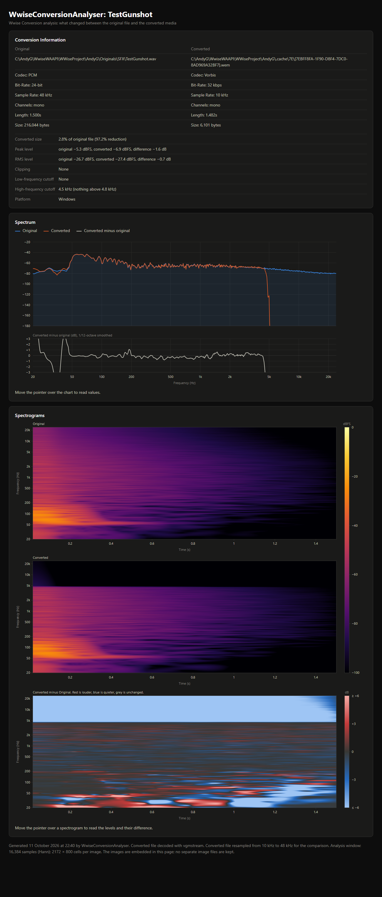

# WwiseConversionAnalyser

A right-click tool for [Audiokinetic Wwise](https://www.audiokinetic.com/products/wwise/) that shows what audio
conversion did to a Sound. It opens a report in your web browser comparing the original file with the converted
one: size, levels, clipping, frequency cutoffs, spectrum and spectrograms.

It only reads from Wwise. Nothing in the project is changed.



## Install

Windows only.

1. Install [Python](https://www.python.org/downloads/) 3.8 or later, then in a terminal run:

   ```
   py -m pip install numpy waapi-client
   ```

2. Copy this folder into your Wwise project Add-Ons\Commands folder, so that it is:

   ```
   <your Wwise project>\Add-ons\Commands\WwiseConversionAnalyser
   ```

   The folder must have exactly that name. A ZIP from GitHub unpacks as `WwiseConversionAnalyser-main`: rename it.

3. In Wwise, open **Project > User Preferences** and tick **Enable Wwise Authoring API**.

4. Restart Wwise if it was already open when you installed the script.

## Use

Select one or more Sounds (Sound SFX asset in Wwise), right-click, expand **AndyGBass** from the dropdown and choose:

- **WwiseConversionAnalyser** to compare each file with its channels mixed to mono, or
- **WwiseConversionAnalyser (per-channel)** to compare every channel on its own.

The report opens in your web browser.

## More

- [Reading the report](docs/reading-the-report.md)
- [Troubleshooting and limitations](docs/troubleshooting.md)
- [Command-line options](docs/command-line.md)
- [How it works](docs/how-it-works.md)
- [Changelog](CHANGELOG.md)

## Included software: vgmstream

This download includes [vgmstream](https://github.com/vgmstream/vgmstream), in the `vgmstream-win64` folder.
The tool uses it to decode Wwise's `.wem` files.

vgmstream is a separate project by its own authors. It has its own licence, and it comes with further libraries
that have theirs. **Before you use or share this download, please read:**

- [`vgmstream-win64/README.md`](vgmstream-win64/README.md), vgmstream's own readme
- [`vgmstream-win64/COPYING`](vgmstream-win64/COPYING), vgmstream's licence
- [`THIRD_PARTY_NOTICES.md`](THIRD_PARTY_NOTICES.md), the libraries that come with it and their licences

## Licence

WwiseConversionAnalyser itself is released under the [MIT License](LICENSE). That licence does not cover
vgmstream or the libraries that come with it.

Wwise is a trademark of Audiokinetic Inc. This project is not affiliated with or endorsed by Audiokinetic.
